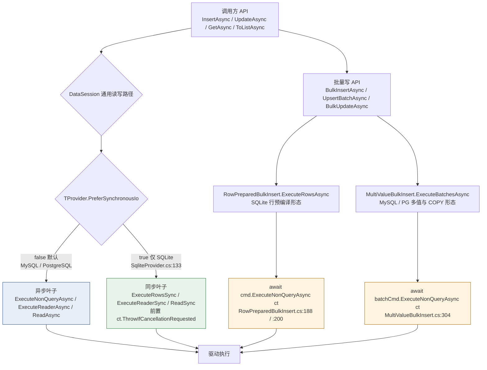

# 同步叶子与批量写异步叶子的分工（2026-11-07）

> 配套：`docs/高并发压测方案-2026-11-06.md` 与 `test/PalORM.Core.Tests/TestSupport/FaultInjection/ConnectionReuseFaultTests.cs`。
> 本文回答「`PreferSynchronousIo` 的三处已上线同步叶子，与批量写仍走异步叶子，是怎么分工的」。

## 结论

分流发生在**命令执行叶子**这一层，按 `IDbProvider.PreferSynchronousIo` 能力位判定。该能力位默认 `false`，只有 SQLite 覆写为 `true`。**通用读写路径**的三处叶子（写、读、逐行读）因此只对 SQLite 走同步调用；**批量写骨架**刻意不经过这三处叶子，硬编码 `await ExecuteNonQueryAsync`，全方言保持异步。两者并存是按实测决定是否动热路径的结果，不是设计不一致。

## 调用路径图

## 逐项依据

| 路径 | 锚点 | 形态 |
|---|---|---|
| 能力位默认值 | `src/PalORM.Core/IDbProvider.cs:157` | `static virtual bool PreferSynchronousIo => false` |
| SQLite 覆写 | `src/PalORM.Sqlite/SqliteProvider.cs:133` | `true`。理由在 `:130-132`：进程内引擎的异步 API 内部本就是同步执行，异步形态只多付 Task 与状态机脚手架 |
| 写叶子分流 | `src/PalORM.Core/DataSession.cs:1768-1777` | `ExecuteRowsCoreAsync` 三目分流，同步分支走 `ExecuteRowsSync`（前置取消检查后调 `command.ExecuteNonQuery()`） |
| 读叶子分流 | `src/PalORM.Core/DataSession.cs:1780-1789` | `ExecuteReaderAsync`，同上形态 |
| 逐行读分流 | `src/PalORM.Core/DataSession.cs:1792-1800` | `ReadAsync`，同上形态 |
| SQLite 批量写 | `src/PalORM.Core/RowPreparedBulkInsert.cs:188`、`:200` | 行循环硬编码 `await cmd.ExecuteNonQueryAsync(ct)`，不经 `ExecuteRowsCoreAsync` |
| MySQL / PG 批量写 | `src/PalORM.Core/MultiValueBulkInsert.cs:304` | 批命令 `await batchCmd.ExecuteNonQueryAsync(ct)` |

## 为什么批量写没有同步化

`docs/性能优化方案-全量重读终版-2026-11-06.md` 的 F1 曾提案给 `RowPreparedBulkInsert` 加 `bool syncIo` 重载、由 `SqliteProvider` 传 `PreferSynchronousIo`，目标是收窄 SQLite BulkInsert 的 +46.0ns/行。PERF-0.1 的 A/B 探针结论是 **NEGATIVE**：

- 11 轮逐轮 paired 比值中位数 1.0039，sync 反而慢 0.39%
- 确定性指标（分配）两臂逐位相同，775.2 B/行
- 与 9 轮驱动级先验（sync 慢 2.2%、分配相同）同向

按方案「正收益才动代码，证伪即丢弃」，阶段 1 整体丢弃，`RowPreparedBulkInsert.cs`、`SqliteProvider.cs`、`DataSession_Bulk.cs` 零改动。首版 naive 报的「sync 快 16.5%」是两臂实际耗时共漂移下「分别取中位数再相除」的失真，已用 A/A 噪声带与 K=3 min-filter 证伪。

## 会不会阻塞

不会。同步调用是否有害取决于底层是否存在真实 IO 等待：

| 场景 | 同步调用的实际行为 | 判定 |
|---|---|---|
| MySQL / PostgreSQL | `ExecuteNonQuery()` 在 socket 上同步等 RTT，占住线程池线程 | 有害，故方案 §3 明确关闭「网络方言同步命令 opt-in」 |
| SQLite | `ExecuteNonQuery()` 直接在调用线程跑进程内 C 引擎；驱动的 `ExecuteNonQueryAsync` 内部同步执行完就返回已完成的 Task | 中性，只省一层状态机 |

库把同步化收进 `PreferSynchronousIo` 这个按方言声明的能力位，只对进程内引擎开放，网络方言全程异步。取消语义的代价是粒度变粗：同步叶子在每行/每命令前置 `ct.ThrowIfCancellationRequested()`，与 `DataSession` 既有形态一致；批量写仍保留了每行 `await` 的细粒度取消。

## 易混术语

| 词 | 含义 |
|---|---|
| `sync` 叶子 / sync 臂 | `cmd.ExecuteNonQuery()` 这类**同步 IO 调用**，与异步相反 |
| `_sync` 字段 | `System.Threading.Lock` 实例，命名来自 synchronization，是**线程互斥锁**，也与异步相反（`SessionOperationState.cs:22`） |
| `AsyncLocal` | 追踪「当前异步执行流属于哪个操作」的上下文槽，不是锁（`SessionOperationState.cs:23`、`:24`、`:330`） |
