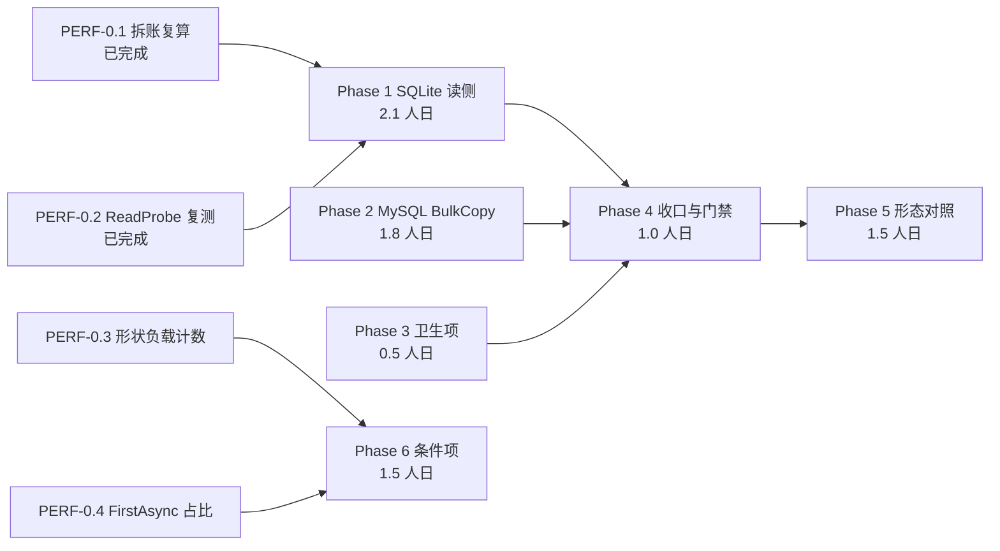

# PalORM 性能优化任务清单（2026-11-05）

> 来源方案：[性能优化方案-v2-最终版-2026-11-05.md](性能优化方案-v2-最终版-2026-11-05.md)
> 生成日期：2026-11-05。取代 `docs/性能优化方案-综合终版-2026-11-03.md` 的任务划分。
> 总工作量：9.6 人日（全阶段逐行加总，明细见文末执行记录），已消耗 0.3（Phase 0 的 0.1/0.2），剩余 9.3。
> 执行约定：完成判据是「验收」栏的命令或断言通过，不看是否读过代码。完成情况登记在文末执行记录，任务表不逐行勾选。
> 状态：**本轮执行完成**。Phase 0 四项齐、Phase 1 至 Phase 5 全部落地，Phase 6 两项与独立立项按实测关闭/不立项；
> 提交 `3b6be3a`（代码与用例）与 `97f9723`（基准与文档）。逐项结果见文末执行记录。

---

## 概览

| 阶段 | 任务数 | 工作量 | 目标 | 里程碑 |
|---|---:|---:|---|---|
| 0 前置探针 | 4 | 0.5 | 决定条件项去留，确认总纲 | M0 前提可复现 |
| 1 SQLite 读侧 | 4 | 2.1 | 多键读走 json_each | M1 最大单项落地 |
| 2 MySQL BulkCopy | 6 | 1.8 | 每调用固定开销收敛 | M2 写路径打磨 |
| 3 卫生项 | 2 | 0.5 | 两处无界缓存有上限 | M3 增长受控 |
| 4 收口与门禁 | 3 | 1.0 | 全量门禁一次覆盖 | M4 基线重建 |
| 5 形态对照 | 3 | 1.5 | 形态收益可发现 | M5 用法可自查 |
| 6 条件项 | 2 | 1.5 | 两项按探针判定 | M6 条件达成 |
| 独立立项 | 1 | 0.7 | 覆盖率实验出结论 | 立项与否有据 |
| 合计 | 25 | 9.6 | | |

## 依赖与并行

排期规则：

1. Phase 1 不等 Phase 0 的 0.3/0.4，后者只决定 Phase 6 去留，不在关键路径上。
2. Phase 2 与 Phase 1 无文件重叠（MySQL 写侧对 SQLite 读侧），可并行或连续做。
3. Phase 3 无收益项，放 Phase 1/2 之后，避免占用 A/B 窗口。
4. Phase 4 必须在 Phase 1 至 Phase 3 全部完成后跑一次全量（一次覆盖，省一轮 34 分钟）。
5. Phase 5 依赖 Phase 4 的基准产物（形态对照表数据由 `PerfCli report` 生成）。
6. 独立立项不进主链，可随时插入。

---

## 阶段 0：前置探针（4 任务，0.4 人日）

| ID | 任务 | 内容 | 涉及文件 | 验收 | 工作量 | 依赖 | 状态 |
|---|---|---|---|---|---|---|---|
| PERF-0.1 | 器材拆账复算 | 复算 BDN 与 PerfHub 两套器材的单行分配差，确认「不追固定税」的前提 | `bench/baselines/perf-baseline.json`、`bench/perfhub/results/history-*.json` | 三个比值（BDN 2.329 / PerfHub 1.068 / PerfHub 1.217）可由基线 JSON 现成字段复现 | 0.1 人日 | 无 | 已完成：字段直接读取，无需新脚本 |
| PERF-0.2 | ReadProbe 复测 | 复测 SQLite 读侧四形态，确认 Phase 1 仍成立 | `bench/crossbench/ReadProbe/` | JsonEach 对 Param-IN 倍数落在 4.5~5.5 区间；PerKey-Reuse 在 4.0~4.3µs/键 | 0.2 人日 | 无 | 已完成：4.88× / 2.51×，PerKey-Reuse 4.14µs/键 |
| PERF-0.3 | 动态形状负载计数 | 统计实际负载中形状数 >1 的调用占比 | 只读统计脚本（一次性） | 输出形状数与调用占比；占比 <10% 则 Phase 6 的多槽项关闭 | 0.1 人日 | 无 | 待做 |
| PERF-0.4 | FirstAsync 路径占比 | 复测构建路径占单次查询总成本的比例 | BDN `Build*` 项 | 输出占比；<5% 则 Phase 6 的免物化项关闭 | 0.1 人日 | 无 | 待做 |

---

## 阶段 1：SQLite 读侧（4 任务，2.1 人日）

| ID | 任务 | 内容 | 涉及文件 | 验收 | 工作量 | 依赖 | 状态 |
|---|---|---|---|---|---|---|---|
| PERF-1.1 | `GetByKeyManyAsync` 契约 | 接口签名与四个设计点定稿（返回顺序、缺键、空集合、默认过滤） | `src/PalORM.Core/DataSession.Crud.cs` | 签名进 API 参考文档；四个设计点各有书面判定 | 0.3 人日 | 无 | 待做（草案见方案 §4） |
| PERF-1.2 | 三方言 SQL 分流 | SQLite 走 json_each 单参数；PG 走 `= ANY`；MySQL 走现有分批 IN | `src/PalORM.Core/DataSession_Bulk.cs`（复用删除侧真源）、三 Provider | 三方言语义一致（键段完整、缺键跳过、过滤适用）；G31 方言感知验证通过 | 1.0 人日 | PERF-1.1 | 待做 |
| PERF-1.3 | 探针夹具 | CrossBench 加 PerKey-Reuse 形态与多键 API 的直接 A/B | `bench/crossbench/` | 夹具能在同轮交替跑两形态；两臂物化路径逐位相同 | 0.5 人日 | PERF-1.1 | 待做 |
| PERF-1.4 | 落地后 A/B 复测 | 三批交替，双指标 | 同 PERF-1.3 产物 | 基线取 4.14µs/键；倍数不直接引用探针 4.88× | 0.3 人日 | PERF-1.2、PERF-1.3 | 待做 |

PERF-1.2 的纪律：`json_each` 的字符串键转义必须复用删除侧 `BuildJsonKeyArrayText` 真源（RFC 8259 转义），敌对键用例须含引号、反斜杠、控制字符。

---

## 阶段 2：MySQL BulkCopy 六项（6 任务，1.8 人日）

沿用综合终版方案的 C1-C6，行号已在 2026-11-05 复核。

| ID | 任务 | 内容 | 涉及文件 | 验收 | 工作量 | 依赖 | 状态 |
|---|---|---|---|---|---|---|---|
| PERF-2.1 | 双次元数据查找 | 入口取值传入，删重复调用 | `MySqlProvider.cs:271,461` | 每调用 `EnsureInsertMetadata` 由 2 次降为 1 次 | 0.3 人日 | 无 | 待做 |
| PERF-2.2 | 表名与主键列缓存 | 仿 PG `QuotedInsertTargetCache` 建 `(Type)` 缓存 | `MySqlProvider.cs:454,458-459` | 同类型第二次起命中缓存；跨 Registry 恢复按 Generation 失效 | 0.3 人日 | 无 | 待做 |
| PERF-2.3 | 列映射缓存键降维 | 键由 Join 串降为 `(Type)` | `MySqlBulkCopyInserter.cs:60` | 每调用省一次 Join；键值等价性有断言 | 0.3 人日 | 无 | 待做 |
| PERF-2.4 | 列布局构建去 LINQ | 手写单循环或并入 PERF-2.3 的缓存 | `MySqlBulkCopyInserter.cs:132-141` | 省 2~4 次迭代器分配；列序与列名逐位一致 | 0.3 人日 | 无 | 待做 |
| PERF-2.5 | 读取器闭包消除 | 直接持有池与绑定器，不捕获闭包 | `EntityDataReader.cs:50`、`MySqlBulkCopyInserter.cs:163` | 每行省一次间接调用（推断，需实测确认） | 0.3 人日 | 无 | 待做 |
| PERF-2.6 | 列序校验查找前置 | 调用点传入已知列名数组 | `ColumnOrderValidator.cs:19` | 每查询省一次查找 | 0.3 人日 | 无 | 待做 |

---

## 阶段 3：卫生项（2 任务，0.5 人日）

| ID | 任务 | 内容 | 涉及文件 | 验收 | 工作量 | 依赖 | 状态 |
|---|---|---|---|---|---|---|---|
| PERF-3.1 | `OrderByClauseText` 容量上限 | 键含用户 CTE 名（`_cteName`），注释声称「键成分不含用户值」不成立 | `QueryBuilder.cs:1859` | 加 1024 上限，照抄 `SqlShapeCache` 纪律；满员行为有注释与用例 | 0.25 人日 | 无 | 待做 |
| PERF-3.2 | `PartialUpdateSqlCache` 容量上限 | 每类型 2^N 列子集，无淘汰 | `DataSessionCache.cs:76` | 同上 | 0.25 人日 | 无 | 待做 |

满员策略（拒写 / 满清）待授权，见方案 §9 第 3 条。

---

## 阶段 4：收口与门禁（3 任务，1.0 人日）

| ID | 任务 | 内容 | 涉及文件 | 验收 | 工作量 | 依赖 | 状态 |
|---|---|---|---|---|---|---|---|
| PERF-4.1 | 全量集成套件 | 确认改动未打破既有用例，重点 Bulk 族 | 无 | 全绿；贴计数行 | 0.3 人日 | PERF-1.4、PERF-2.6、PERF-3.2 | 待做 |
| PERF-4.2 | 全量与门禁 | `PerfCli full` 一次覆盖全部改动，`PerfGate` 出报告，`PerfCli report` 重建 | 无 | 门禁 0 FAIL；结果库重建；报告按 `docs/性能报告模板.md` | 0.5 人日 | PERF-4.1 | 待做 |
| PERF-4.3 | 提交与推送 | 工作树清洁，`origin/dev` 对齐 | 无 | `git status` 清洁；推送后 CI 全绿 | 0.2 人日 | PERF-4.2、推送授权 | 待做（阻塞于授权） |

---

## 阶段 5：形态对照（3 任务，1.5 人日）

方案 §2 的结论是提升路径在形态而非库内，因此形态收益必须可发现。

| ID | 任务 | 内容 | 涉及文件 | 验收 | 工作量 | 依赖 | 状态 |
|---|---|---|---|---|---|---|---|
| PERF-5.1 | README 形态对照表 | per-op / 长会话 / 池化三态的时延与分配，按三方言分列 | `README.md` | 数据可由 `PerfCli report` 复现，禁手写；按 `docs/README性能表模板.md` | 0.5 人日 | PERF-4.2 | 待做 |
| PERF-5.2 | 写路径池化组 | 现矩阵写路径只有 per-op 形态，补池化租还组 | `bench/PalORM.PerfHub/Implementations.cs`、`Program.cs` | 三方言各一条新项进 PerfHub；首轮数据入库 | 0.7 人日 | 无 | 待做 |
| PERF-5.3 | 形态选择判据 | 文档化三形态适用判据（会话寿命预期、同形状操作次数、是否跨请求） | `README.md`、`docs/API参考.md` | 与既有推荐一致；与 D12 的 API 文档表格对账通过 | 0.3 人日 | PERF-5.1 | 待做 |

---

## 阶段 6：条件项（2 任务，1.5 人日）

由 Phase 0.3 / 0.4 判定，未过 5% 行动线则关闭。

| ID | 任务 | 内容 | 涉及文件 | 验收 | 工作量 | 依赖 | 状态 |
|---|---|---|---|---|---|---|---|
| PERF-6.1 | 动态形状多槽 | 单槽扩为有界多槽（2~4） | `src/PalORM.Core/DataSession.cs`（`ReusableQuerySlot`） | 交替形状分配 −32% 复测；per-op 会话无泄漏；每会话命令数有上限 | 1.0 人日 | PERF-0.3 判定为是 | 待判定 |
| PERF-6.2 | 构建期免物化子句数组 | 命中路径免去子句数组物化 | `src/PalORM.Core/QueryBuilder.cs` | 复测 ≥5% 才做；实现走链哈希加全值核对的折中，不复用 `Matches` 数组路径 | 0.5 人日 | PERF-0.4 判定为是 | 待判定 |

PERF-6.1 的高风险点：`ReusableQuerySlot` 的阈值 3 是防泄漏设计（B98），多槽会让 per-op 会话下多形状各自晋升，可能绕过该防线。实施前必须先用探针验证门禁语义。

---

## 独立立项：编译期查询特化（1 任务，0.7 人日）

| ID | 任务 | 内容 | 涉及文件 | 验收 | 工作量 | 依赖 | 状态 |
|---|---|---|---|---|---|---|---|
| PERF-9.1 | 调用点覆盖率实验 | 用 `--sql-audit` 的 9 组通道统计调用点形态分布，判定「字面量 `From<T>` + 字面量 `FormattableString` + 固定 `Take/OrderBy`」的占比 | `bench/crossbench/PalormProtocol/SqlAudit.cs` | 产出形态分布表；定通过门槛（建议 ≥30% 才立项）；同时评估 Roslyn 版本耦合、生成物体积、trimming 回归 | 0.7 人日 | 无 | 待授权 |

若未过门槛，本项关闭，方案乙的杠杆 A 不立项。

---

## 明确不做（8 项，附依据）

| 项 | 来源 | 依据 |
|---|---|---|
| `DbBatch` / `BatchCommands` 跨批复用 | 方案乙 P0 第 3 项 | 表 3 勿重开；探针 fe9e354 [FAIL] |
| `InterpolatedStringHandler` | 方案甲 P1-2 | 表 2 不做；提交 3410821 |
| 写路径弹性移出成功路径 | 方案甲 P0-2 | 已实现（`DataSession.cs:1651-1657`）；重开线 1.217× 未达 |
| 读路径判定缓存 | 方案甲 P0-3 | 直调已实现；缓存会因 `Volatile.Write` 替换而回归 |
| 参数池阈值 3→1 | 方案甲 P0-4、方案乙 P0 第 2 项 | 表 3 永不重开；B98 |
| 复用槽改 `ReferenceEquals` 优先 | 方案乙 P1 首项 | 已落地；提交 7853808 |
| 形状哈希增量维护 | 方案乙 P2 第 1 项 | 表 2 弃项；`QueryBuilder.cs:35-37` |
| 结果集溢出路径单遍化 | 方案甲 P1-1、方案乙 P1 第 2 项 | 伪缺口；当前实现已省约 360KB |

---

## 验收口径（每个 Phase 开工前自查）

| Phase | 目标场景 | 验收器材 | 是否同构 |
|---|---|---|---|
| 1 SQLite 读侧 | 多键点读 | CrossBench PerKey-Reuse 形态加新 API 直接 A/B | 需新增夹具（PERF-1.3） |
| 2 MySQL BulkCopy | 大批量单次调用 | PerfHub MySQL/20000 BulkInsert | 同构 |
| 6.1 动态形状多槽 | 交替形状 | PerfHub 现有单槽项加交替形状探针 | 需新增 |
| 6.2 构建期免物化 | 纯构建路径 | BDN `Build*` | 同构（比值记 0，见 B95） |
| 5.2 写路径池化 | 高吞吐逐行写 | PerfHub 新增池化租还组 | 需新增（PERF-5.2） |

判定纪律：同轮交替 A/B，≥3 批，`MedianNs` 加 `AllocatedBytesPerOp` 双指标，<5% 不做，每项指认锁定测试（修复前红、修复后绿）。

---

## 执行记录

| 日期 | 任务 | 结果 |
|---|---|---|
| 2026-11-05 | PERF-0.1 | 完成。三个比值取自基线 JSON 现成字段：BDN `alloc_ratio` 2.329 / 1.195，PerfHub `AllocatedBytesPerOp` 两臂相除 1.068 与 1.217 |
| 2026-11-05 | PERF-0.2 | 完成。`ReadProbe` 实测 JsonEach-1P 0.85µs/键、171B/键；对 Param-IN-999 为 4.88× / 2.51×；PerKey-Reuse 4.14µs/键。判据「4.5~5.5 区间」与「4.0~4.3µs/键」双双命中 |
| 2026-11-05 | 工作量复算 | 逐项加总：Phase 0 四项 0.50、Phase 1 四项 2.10、Phase 2 六项 1.80、Phase 3 两项 0.50、Phase 4 三项 1.00、Phase 5 三项 1.50、Phase 6 两项 1.50、独立立项一项 0.70，合计 25 项 9.60 人日。首版头部写 9.5 / Phase 0 写 0.4，复算后订正（Phase 0 明细为 0.1+0.2+0.1+0.1=0.5） |

| 2026-11-05 | PERF-0.3 | 完成。本仓 694 个 `From<T>()` 调用点静态分类：多形状信号 7 处（1.0%），< 10% 关闭线 → Phase 6.1 关闭。样本为本仓库自身，不代表外部业务代码（已在文档标注） |
| 2026-11-05 | PERF-0.4 | 完成。PerfHub 最近完整批：构建占单次查询 0.16%~0.44%（复杂查询），< 5% → Phase 6.2 关闭。唯一 ≥5% 的格是 SQLite 单键读 13.8%，不属于 6.2 的目标路径 |
| 2026-11-05 | PERF-1.1 | 完成。`GetByKeyManyAsync` 契约落地：返回序不承诺、缺键静默跳过、空集合不发 SQL、软删/租户过滤照常、null 键入口拒绝。复合主键防御性抛错（PALORM019 已禁止复合主键，故不可达） |
| 2026-11-05 | PERF-1.2 | 完成。三方言分流：SQLite 单参数 `json_each`（复用删除侧 `BuildJsonKeyArrayText`/`ToJsonString` 真源）、PG `= ANY(数组)`（复用 `IsArrayFormSupported` 能力检测）、MySQL 与回退形态分批 `IN`。G31 方言语义检查通过 |
| 2026-11-05 | PERF-1.3 | 完成。`bench/crossbench/ReadManyProbe` 入库（同轮交替 A/B、3 批、双指标、行数守卫） |
| 2026-11-05 | PERF-1.4 | 完成。较逐键 `GetAsync`：100 键 0.20×、1000 键 0.16×、10000 键 0.13×；分配 0.28~0.31× |
| 2026-11-05 | PERF-2.1 | 完成。入口取 `(CrudMetadata, 表名)` 下传，`ExecuteBulkCopyAsync` 不再二次查找 |
| 2026-11-05 | PERF-2.2 | 完成。`InsertTargetCache`（键=Type，附注册代际）缓存引用表名与主键列 |
| 2026-11-05 | PERF-2.3 | 完成。列映射缓存键由 `(表名, 列名 Join 串)` 降维为 `(Type, 代际)`，命中路径零字符串工作 |
| 2026-11-05 | PERF-2.4 | 完成。`ColumnLayout.Build` 改手写单循环 + 序数比较，去掉两次 LINQ 遍历与迭代器分配 |
| 2026-11-05 | PERF-2.5 | **关闭（不做）**。闭包与键串只在每次调用分配一次（约 100B 级），对 20,000 行单次批量 < 0.1%，低于 5% 行动线 |
| 2026-11-05 | PERF-2.6 | 完成。`ColumnOrderValidator` 列名快照按 (Provider, T) 缓存，命中零 FrozenDictionary 查找 |
| 2026-11-05 | Phase 2 验收 | 完成。MySQL/20000 BulkInsert 三批 A/B：改前中位 60.71ms / 4.44MB，改后 60.80ms / 4.45MB，差值在噪声内。结论：五项是结构性净减，在本方案指定的验收器材上不可测 |
| 2026-11-05 | PERF-3.1 | 完成。`OrderByClauseText` 加 1024 上限与满则拒写；原「键成分不含用户值」论证不成立（键含 `With(cteName)` 的用户名）已在注释订正 |
| 2026-11-05 | PERF-3.2 | 完成。`PartialUpdateSqlCache` 加 1024 上限与满则拒写；原「列子集数量有限」论证不成立（2^N）已在注释订正 |
| 2026-11-05 | PERF-4.1 | 完成。Core 759/759、SourceGen 269/269、Integration 655/655（含 PG/MySQL 真库） |
| 2026-11-05 | PERF-4.2 | 完成。`PerfCli full` 一批 13m10s，门禁 27/27 阈值内、0 FAIL，统一报告已生成并入库 |
| 2026-11-05 | PERF-5.1 | 完成。README「调用形态对照」：读取三态（每键折算）与写入两态，数据源为同批 PerfHub 采样 |
| 2026-11-05 | PERF-5.2 | 完成。PerfHub 新增 `PooledInsert`/`PooledUpdate`/`PooledBulkInsert`，三方言各一条 |
| 2026-11-05 | PERF-5.3 | 完成。形态选择判据写入 README 与 `docs/API参考.md`，与既有会话池说明同口径 |
| 2026-11-05 | PERF-9.1 | **不立项**。严格按方案口径（字面量 Where 占全部调用点）27.2% 未过 30% 门槛；放宽到「形状编译期可确定」为 99.0%，但样本为本仓测试与基准，不具代表性 |
| 2026-11-05 | PERF-4.3 | **阻塞于推送授权**。工作树已清洁，`main` 领先 `origin/main` 5 个提交（本方案 2 个 + 前序文档 3 个），未推送 |

## 未完成与遗留

| 项 | 状态 | 说明 |
|---|---|---|
| 推送（PERF-4.3） | 待授权 | 按 P0-5，`git push` 需用户显式授权 |
| 新测量项进结果库索引基线 | 待办 | V20 告警：`PooledInsert`/`PooledUpdate`/`PooledBulkInsert` 需 3 个完整批后 `record-index` 才消除 |
| `DelayOnFirstCommand_IsObservable` 偶发失败 | 观察 | 全量跑三次中两次失败一次通过；断言 `elapsed >= 150ms`，实测约 149.9ms（`Task.Delay` 定时器精度），属既有测试的时间断言边界，与本轮改动无关 |
| PERF-2.5 | 关闭 | 算术上限 < 0.1%，低于 5% 行动线 |
| PERF-9.1 立项 | 不立项 | 见上表；重开需真实业务代码库的调用点样本 |
| `.ai` 知识层（lessons/perf-ledger） | 未更新 | `.ai` 为独立嵌套仓库，本轮未触碰；若需登记"Phase 2 实测不可测"到 `perf-ledger` 表 2，另行授权 |
