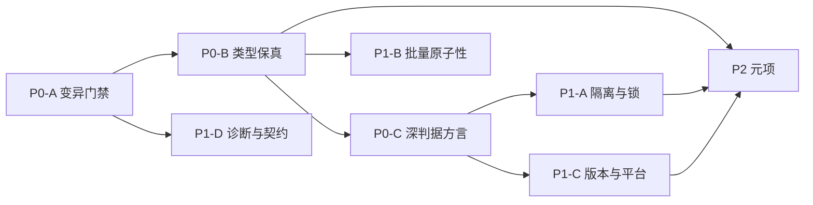

# PalORM 测试体系增强方案（2026-10-31）

> 状态：待实施
> 来源：2026-10-31 测试体系评估与两轮独立只读核验
> 定位：补 ORM 专项盲区，不重建判据体系
> 规模：P0 3 组 14 个任务、P1 4 组 13 个任务、P2 4 个任务，另加 2 个准备任务；P0 与 P1 估算 10 到 14 人日，P2 估算 4 到 6 人日
> 执行入口：配套任务清单 [测试体系增强-任务清单-2026-10-31.md](测试体系增强-任务清单-2026-10-31.md)

## 一、结论

当前测试体系在常用路径与已声明契约上证据充分，在类型边界、方言差异、并发语义、最低版本上证据不足。问题不在用例数量，核心是三条：

1. 六类最强判据只在 SQLite 运行，没有覆盖代码量最大、覆盖率地板最低的 PG Provider。
2. 类型边界没有判据，DDL 已选定 `DATETIME(6)`、`TIMESTAMPTZ`、`DECIMAL(18,6)`，但没有亚秒时间、精度溢出、特殊浮点值的往返断言。
3. 元门禁自身失明，变异工作流连续失败，覆盖率只看行，文档计数有漂移。

本方案不新建判据体系，只把已有机制复制到缺的维度，并先修复变异门禁的构建路径。

## 二、事实基线

| 项 | 数值 | 来源 |
|---|---|---|
| Core 测试 | 693 通过 / 0 失败 / 1m08s | 2026-10-31 本地实测 |
| SourceGen 测试 | 257 通过 / 0 失败 / 47s | 2026-10-31 本地实测 |
| Integration 测试 | 本轮未重跑；文档记录 526 项 | `docs/一致性测试总报告-2026-10-29.md` |
| `[Test]` 严格属性行 | 1427 | 排除 obj/bin 后实测 |
| `[Test]` D10 行扫描 | 1429（含 2 行注释提到 `[Test]`） | `doc-consistency-check.cs` 统计范围 |
| 覆盖率地板 | Core 74%、MySQL 67%、PostgreSQL 46%，均为行覆盖 | `bench/baselines/test-counts.json` |
| 变异工作流 | 最近 4 次定时运行全部 failure，无报告产出 | `gh run list --workflow "Mutation Tests"` |
| 变异本地报告 | 3782 个变异点，Killed 0、Survived 0、Ignored 3160、CompileError 622 | `StrykerOutput/2026-09-30.02-01-38` |
| 六类深判据 | 契约、边界、状态不变量、随机差分、pairwise、变形关系均为 SQLite 固定签名 | `test/PalORM.Integration.Tests/Conformance/` |

### 2.1 三处修正

上一轮评估有三处说得过满，本方案按核验结果修正。

| 原表述 | 核验结果 | 本方案采用 |
|---|---|---|
| 没有批处理第二批失败测试 | 不成立。已有 7 处批内或跨批失败用例 | 缺口收窄为 `BulkInsert` 跨批失败与 `BulkMerge` 跨批回滚断言 |
| 深判据全部只在 SQLite | 部分成立。错误契约、跨方言等价、时间矩阵在 PG/MySQL 执行 | 改为“六类最强判据只在 SQLite” |
| 变异测试零信号 | 更严重。CI 连续失败，根本没有报告；本地报告才是零有效信号 | 增加“变异工作流构建路径失效”独立任务 |

已存在的批处理失败用例，实施时不要重复：

- `test/PalORM.Core.Tests/RowPreparedBulkTests.cs:47` 批内主键冲突，整批 0 行残留。
- `test/PalORM.Core.Tests/BulkDeleteJsonEachTests.cs:174` 第 2 批混入错误类型，首批已删行全部回来。
- `test/PalORM.Integration.Tests/MySqlBatchedUpdatePathTests.cs:57` 第二/末批版本陈旧，整批回滚。
- `test/PalORM.Integration.Tests/PgBatchedUpdatePathTests.cs:54` 同形态 PG 真库回滚。
- `test/PalORM.Core.Tests/BulkUpdatePoolingTests.cs:229` 批中 NOT NULL 违规，整批回滚。
- `test/PalORM.Integration.Tests/SessionBatchDialectTests.cs:15` 第二条语句失败，前一条被回滚。
- `test/PalORM.Integration.Tests/ExternalDatabaseBulkTests.cs:249` MySQL BulkCopy 前两批已写入、第三批被拒，手动回滚后 0 行。

## 三、目标与验收指标

| 编号 | 目标 | 可验证指标 |
|---|---|---|
| G1 | 深判据下沉 PG/MySQL | 至少 20 条能力契约、8 条边界契约、4 条状态不变量在 PG/MySQL 执行；PG 覆盖率地板从 46% 提到 55% 到 60%（建议值，按实测重定） |
| G2 | 类型保真矩阵 | 白名单类型各至少 1 个边界值跑三方言；精确往返或显式登记方言损失；PG 全类型单行往返补齐 |
| G3 | 事务隔离与锁 | 3 条两会话隔离语义用例、1 条死锁与重放用例、3 条锁竞争用例、1 条 aborted transaction 恢复用例 |
| G4 | 批量剩余原子性 | `BulkInsert` 跨批失败、`BulkMerge` 跨批回滚各至少 1 条；断言行数，不只断言异常 |
| G5 | 变异门禁恢复 | 定时 job 绿且报告 Killed > 0；若 MTP 仍空转，输出独立健康指标，不再静默绿 |
| G6 | 版本、平台、文化 | MySQL 8.0.18/8.0.19/8.4 夜间 lane；`de-DE`/`tr-TR`/`fr-FR` 文化切片；Windows Core+SourceGen job |
| G7 | 诊断、API、文档 | 46/46 诊断有触发与不触发用例；破坏性 API 变更在 PR 报红；D10 覆盖全部计数写入点 |
| G8 | 元项 | 分支覆盖地板、flake 台账、SQLite 文件库与加密功能用例、10 万行批量与百万行流式 |

## 四、范围

### 4.1 范围内

- 修复变异工作流的构建路径与无信号可见性。
- 类型保真矩阵、深判据方言下沉、隔离与锁、批量剩余原子性。
- 版本矩阵、文化切片、Windows job。
- 诊断逐码守卫、API 兼容门禁、文档计数同步。
- 分支覆盖、flake 台账、SQLite 文件库、大数据与夜间随机种子。

### 4.2 范围外（勿重开）

| 项 | 否决理由 |
|---|---|
| 表达式翻译矩阵 | `Where` 只有 `FormattableString` 一个重载，没有翻译层 |
| 按 Provider 复制整套测试 | RepoDB 式 3 万多个集成测试成本过高，三方言参数化加 L6 等价更省 |
| 14 条抽象手工变异规则集 | Stryker 覆盖 Core 与 SourceGen 全量，回放规则按“随修随加”增长 |
| 逐字 SQL 全矩阵 | 快照、DryRun 片段、双侧对照、语句坐标守卫已覆盖列序、参数序、子句形态 |
| CI 快慢线拆分 | 当前全量 Integration 约 94 秒，独立夜间 lane 只会重复同一批用例 |
| Stryker 改回 vstest runner | 项目已移除 `Microsoft.NET.Test.Sdk`，没有 VSTest 适配器 |

## 五、任务分组与依赖

| 组 | 任务数 | 目标 | 依赖 |
|---|---|---|---|
| P0-A 变异门禁 | 3 | 修构建路径、验证有效变异、暴露无信号状态 | 无 |
| P0-B 类型保真 | 6 | 三方言类型边界矩阵与 PG 全类型 | 无 |
| P0-C 深判据方言 | 5 | 契约、边界、状态不变量下沉 PG/MySQL | P0-B 提供期望值 |
| P1-A 隔离与锁 | 4 | 隔离语义、死锁、锁竞争、aborted 恢复 | 无 |
| P1-B 批量原子性 | 2 | `BulkInsert` 跨批、`BulkMerge` 回滚 | 无 |
| P1-C 版本与平台 | 3 | MySQL 版本 lane、文化切片、Windows job | 无 |
| P1-D 诊断与契约 | 4 | 46/46 诊断、API diff、文档同步 | 无 |
| P2 元项 | 4 | 分支覆盖、flake、文件库、大数据与随机种子 | P0 与 P1 完成 |

## 六、设计要点

### 6.1 P0-A 变异门禁

现状：`test/PalORM.Core.Tests/stryker-config.json:4` 与 `test/PalORM.SourceGen.Tests/stryker-config.json:4` 都指向 `../../PalORM.slnx`，而 CI 只构建 `PalORM.ci.slnf`。`PalORM.slnx` 含 vendored BenchmarkDotNet 子树，CI 干净检出时该子树不存在，Stryker 初次构建失败。

处置顺序：

1. 新建只含 `src/` 与 `test/` 的 `PalORM.mutation.slnx`，两个 Stryker 配置指向它。
2. 在 CI 的变异 job 里先用同一 solution 做一次 Debug 构建，再跑 Stryker。
3. 用一条已知变异验证 Killed > 0。若 MTP runner 仍空转，记录上游阻塞，同时输出 `effectiveMutants` 健康指标。
4. 不把 exit 3/4 的静默绿当成正常。无信号状态必须在 job summary 或独立检查里可见。

### 6.2 P0-B 类型保真

新增 `test/PalORM.Integration.Tests/TypeFidelityMatrixTests.cs`。用表驱动，方言作为参数，外部库用例加 `[NotInParallel("ExtBulkTable")]`，清理放 `finally`。

覆盖边界：

- `DateTime`：`AddTicks(1)`、`AddTicks(1234567)`、`DateTime.MinValue`、`DateTime.MaxValue`、UTC/Local/Unspecified、DST 边界。
- `DateTimeOffset`：`+14:00`、`-08:00`、DST 前后、跨日。
- `TimeOnly`：`00:00`、`23:59:59.9999999`、毫秒与微秒。
- `DateOnly`：`0001-01-01`、`9999-12-31`。
- `decimal`：scale 6、scale 7、18 位、28 位、`decimal.MaxValue`、`decimal.MinValue`、负数舍入方向。
- `double`/`float`：`NaN`、`PositiveInfinity`、`NegativeInfinity`、`-0.0`、`double.Epsilon`、`MaxValue`、`MinValue`。
- `Guid`：`Guid.Empty`、全 `FF`、版本 4。
- `byte[]`：空数组、`null`、含 `0x00`、1 MB。
- `string`：`null`、空串、emoji、ZWJ 组合、CJK、组合字符、孤立代理项、尾随空格、超长。
- `char`：`'\0'`、非 ASCII。
- 枚举：负值、`long` 底层、`[Flags]`。
- `ulong`：大于 `long.MaxValue`。

每格两种结果：精确往返，或文档声明的方言损失。后者必须写进 `docs/API参考.md` 的方言契约表，并在测试里显式断言损失后的值。

### 6.3 P0-C 深判据方言

不移植全部 432 对 pairwise，先移植方言敏感度最高的子集。

- 能力契约 20 条：显式主键插入、自增回填、`Save` 插入/更新分支、`Update` 存在/不存在、`UpdateColumns`、`Delete` 物理/软删、`Get`、`Count`、`ToPage`、`Upsert`、批量插入、批量更新、批量删除、租户过滤、乐观锁。
- 边界契约 8 条：`Take(0)`、`Skip()+ToPage`、SQLite 行锁拒绝、PG/MySQL 行锁可执行、并发令牌批量更新拒绝、`Save` 并发令牌拒绝、分页续页、软删过滤绕过。
- 状态不变量 4 条：软删分区、租户隔离、查询缓存键、池租还复位。
- 随机差分与 pairwise 放夜间 lane，先各 1 个种子与 50 对，PR 不跑。

契约期望值从 `docs/API参考.md` 与 ADR 取，不把当前行为直接写成契约。遇到方言差异，先判定是契约还是缺陷；是缺陷就修并加回放规则，是契约就写进方言差异表。

### 6.4 P1-A 隔离与锁

两会话确定性用例，用 `TaskCompletionSource`、`pg_sleep`、`GET_LOCK` 控制顺序，不用 sleep 猜时序。

- READ COMMITTED：会话 A 读，B 改并提交，A 再读看到新值。
- REPEATABLE READ：A 读，B 改并提交，A 再读看不到新值。
- SERIALIZABLE：并发写冲突，断言一方失败并可按 `WithTransactionRetry` 重放。
- 死锁：两会话反向加锁，断言 PG 40P01 或 MySQL 1213，重放后成功且副作用只发生一次。
- 锁竞争：`ForUpdate` 第二会话阻塞，`lock_timeout` 报错，`skipLocked` 跳过。
- aborted transaction：PG 语句失败后事务进入 aborted，后续命令失败，回滚后会话可用。

### 6.5 P1-B 批量剩余原子性

- `BulkInsert`：2500 行，`batchSize` 999，第 1500 行唯一冲突；断言 0 行残留或文档声明的已提交前缀。SQLite、PG、MySQL 各一条。
- `BulkMerge`：跨批重复主键；断言异常后行数与内容保持原状。PG 与 MySQL 各一条。

### 6.6 P1-C 版本、平台、文化

- MySQL 夜间 lane：`mysql:8.0.18`、`mysql:8.0.19`、`mysql:8.4`。跑批量更新、Upsert、批量插入、分页；断言 8.0.18 走 `CASE WHEN` 回退，8.0.19 与 8.4 走 `JOIN VALUES ROW`。
- 文化切片：非并行集合，`de-DE`、`tr-TR`、`fr-FR` 下跑 SQL 生成、decimal 参数、日期解析、字符串比较；`finally` 恢复原文化。
- Windows job：夜间 `windows-latest`，跑 Core 与 SourceGen；AOT 可选 `win-x64` 发布。

### 6.7 P1-D 诊断、API、文档

- `PALORM041`：同命名空间两个同名 `[SqlTemplate]` 触发；不同名或不同命名空间不触发。
- 诊断守卫：从分析器描述符枚举 ID，映射到测试引用；缺失即失败，豁免必须写理由。
- API 门禁：引入 `PublicAPI.Shipped.txt` 与 `PublicAPI.Unshipped.txt`，或等价的公开 API 快照脚本；PR 上比对基线。
- 文档同步：`.ai/test/prompt.md` 的 1099 改为指向 `test-counts.json`，不写死数字；`docs/测试体系路线图.md` 的 85%、PG17、P1-A 待实施改为当前事实；D10 覆盖 `.ai` 与路线图。

### 6.8 P2 元项

- 分支覆盖：`assert-coverage.cs` 解析 `branch_coverage`，先对 `QueryBuilder`、`BatchUpdateSqlBuilder` 与三个 Provider 设地板。
- flake 台账：每周 Core 跑 3 次、Integration 跑 2 次，记录首跑失败与重跑通过，不静默重试。
- SQLite 文件库：WAL、双连接 BUSY 重试、只读模式、`Password=` 加密；功能级用例，不只 PRAGMA 单测。
- 大数据与随机种子：10 万行批量、百万行流式的正确性与内存上界；夜间随机种子跑 D 层，失败打印种子与收缩结果。

## 七、执行纪律

1. 每个新增测试必须能失败。用注入/还原或变异探针证明，写不出可失败用例时登记缺口，不进“已覆盖”。
2. 禁止实际耗时断言。并发用屏障与显式顺序，不用 sleep 猜。
3. 外部库用例加 `[NotInParallel("ExtBulkTable")]`，DDL 与数据清理放 `finally`。
4. 新发现的产品缺陷：修复加一条回放规则，提交信息带 `Replay-Rule: R-Dx`。
5. 判定为合理方言行为：写进 `docs/API参考.md` 的方言差异表，并在测试里显式断言，不静默接受。
6. 测试数与覆盖率地板只按实测调整，调整时在同提交写明实测值。
7. 每个任务独立提交，或按阶段合并；提交前跑对应测试与门禁。

## 八、风险与缓解

| 风险 | 等级 | 缓解 |
|---|---|---|
| Stryker MTP runner 仍空转 | 高 | 先修构建路径；仍空转则输出健康指标，不静默绿，按季度复查上游 |
| 类型边界暴露产品缺陷 | 中 | 先判定契约还是缺陷；缺陷修复加回放，契约写进文档并钉行为 |
| 隔离与死锁用例 flaky | 中 | 屏障与显式顺序；失败不自动重试，先分类再修 |
| PG/MySQL 版本 lane 运行时间长 | 中 | 放夜间，PR 只跑当前版本 |
| Windows job 成本高 | 低 | 只跑 Core 与 SourceGen，不跑全量 Integration |
| API 基线首次引入噪声大 | 中 | 先冻结当前公开面，只阻断新增破坏性变更 |
| 覆盖率地板调整被误读为达标 | 中 | 地板注释写明“防退化非达标”，目标值单列 |

## 九、总验收

| 项 | 命令或判据 |
|---|---|
| 构建 | `dotnet build PalORM.ci.slnf -c Debug` 0 警告 0 错误 |
| 单元 | `dotnet run --project test/PalORM.Core.Tests -c Debug` 0 失败 |
| 源生成 | `dotnet run --project test/PalORM.SourceGen.Tests -c Debug` 0 失败 |
| 集成 | `dotnet run --project test/PalORM.Integration.Tests -c Debug` 0 失败，外部库分类计数不低于地板 |
| 新用例 | 类型矩阵、方言契约、隔离锁、批量原子性全部通过，且每类至少一条做过注入报红验证 |
| 变异 | 定时 job 绿且 Killed > 0；若仍空转，健康指标可见 |
| 覆盖率 | Core、MySQL、PostgreSQL 行覆盖不低于新地板；分支覆盖地板生效 |
| 门禁 | `test-gate.cs --ci`、`doc-consistency-check.cs`、`gate-check.cs --allow-dirty`、`tech-debt-scan.cs --ci` 全绿 |
| 文档 | D10 覆盖全部计数写入点；路线图与测试体系规范无过期状态；grep 旧值零残留 |

## 十、交付物

| 交付物 | 位置 |
|---|---|
| 方案 | `docs/测试体系增强方案-2026-10-31.md` |
| 任务清单 | `docs/测试体系增强-任务清单-2026-10-31.md` |
| 类型矩阵 | `test/PalORM.Integration.Tests/TypeFidelityMatrixTests.cs` |
| 方言契约 | `test/PalORM.Integration.Tests/Conformance/` 下新增或参数化文件 |
| 隔离与锁 | `test/PalORM.Integration.Tests/TransactionIsolationTests.cs` 等 |
| 变异配置 | `PalORM.mutation.slnx`、两个 `stryker-config.json`、`mutation-tests.yml` |
| 诊断守卫 | `test/PalORM.SourceGen.Tests/DiagnosticCoverageTests.cs` |
| API 基线 | `src/PalORM.Core/PublicAPI.Shipped.txt` 等 |
| 文档同步 | `.ai/test/prompt.md`、`docs/测试体系路线图.md`、`docs/测试体系规范.md` |
