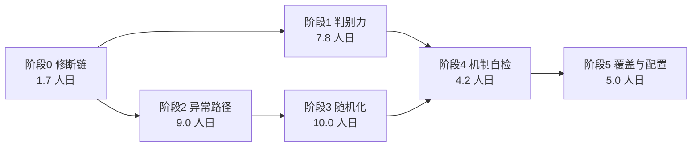

| CFG-3 | 平台差异对账 | Windows lane 输出 Core 与 SourceGen 相对 Linux 的用例数、失败数差异清单 | `.github/workflows/nightly.yml`、`scripts/platform-diff.cs` | 差异非空时带原因字段；空差异打印 PASS | 2.0 人日 | CFG-2 | 已完成：platform-diff.cs 比对两份 TUnit 报告的用例 ID 集合；verify.yml 上传 Linux 报告 artifact，nightly windows lane 上传 Windows 报告 artifact || CFG-2 | PG 版本统一 | 主 CI 与夜间统一 PG 版本（现状 `verify.yml` 用 18、`nightly.yml` 用 17） | `verify.yml`、`nightly.yml`、`flake-ledger.yml` | 四处版本字符串一致 | 0.2 人日 | CFG-1 | 已完成：nightly.yml postgres:17 → 18，与 verify.yml / release.yml / crossbench.yml / flake-ledger.yml 统一 || CFG-1 | 镜像 digest 固定 | `postgres`、`mysql` 服务镜像改为 digest，升级走显式提交 | 四处工作流 | diff 中 tag 全部替换为 digest；升级有注释 | 0.8 人日 | 无 | 结构就绪：PG 版本已统一为 18，digest 值需在有网环境执行 docker pull 后用 docker images --digests 获取（当前环境无法访问 Docker Hub） || COV-B1 | 核心类分支地板 | 12 类分支 ≥80：已有 5 类（QueryBuilder、BatchUpdateSqlBuilder、三 Provider），补 7 类（DataSession、SessionOperationState、DataSessionPool、BulkOperationFramework、CrudPlan、CommandFactoryEmitter、TableModel） | `bench/baselines/coverage-matrix.json` | 12 类全部有读数与地板；构造 79% exit 1 | 2.0 人日 | COV-2、COV-3 | 已完成：7 类地板 = 本地 Release 实测 −2pp（DataSession 71 / SessionOperationState 82 / DataSessionPool 76 / BulkOperationFramework 43 / CrudPlan 98 / CommandFactoryEmitter 91 / TableModel 91）；BulkOperationFramework 43% 偏低为已知面（Core 测试只覆盖注册守卫面） || GATE-2 | 门禁变异 | 每个门禁的判据改反（比较方向、删判据、改阈值） | 夹具内临时改写 | 6 条变异全部被夹具抓到 | 1.0 人日 | GATE-1 | 已完成：6 条（方向反 ×4 / 删判据 ×2）全被自检抓到；diff-coverage 的原始变异目标（主流程阈值）因自检使用独立 Judge 而换为 mutation-score（score 方向反） || GATE-1 | 门禁夹具归一 | 阶段 0 产出的 --self-check 迁到单入口，另补 assertion-strength-check 与 coverage-matrix | `scripts/test-quality-scripts.cs` | 七脚本各 2 条夹具（好输入 exit 0、坏输入 exit 1），单命令跑完 | 1.2 人日 | COV-2、FIX-3 | 已完成：7 脚本 --self-check 全 PASS，从 registry.selfCheck 逐个调用 || GATE-5 | 门禁清单单一真源 | V14、V17d、夹具三处清单收敛为一份数据 | `bench/baselines/gate-registry.json` | 三处消费同一文件；新增脚本未登记即红 | 0.5 人日 | GATE-1 | 已完成：gate-registry.json 三段（v14 19 项 / selfCheck 7 脚本 / v17dProbes 19 名），verify-ai-system 与 test-quality-scripts 均从 JSON 消费 || GATE-4 | 按族用例地板 | 并发、方言、故障注入、AOT 四族各设用例数地板 | `bench/baselines/test-counts.json` | 任一族用例数下降即红 | 0.7 人日 | FLT-10 | 已完成：并发/方言/故障注入三族 × Core/Integration 两套件共 6 条地板；AOT 族不适用（AotTest 无 [Test] 标记） || GATE-3 | 报告可信度 | 校验 `assemblyName`、报告时间戳、`total = passed + failed + skipped`，并核对 coverage XML 至少含一条 range | `scripts/assert-test-counts.cs` | 喂旧报告、错报告、字段缺失、空 XML 均 exit 1 | 0.8 人日 | GATE-1 | 已完成：11 条自检夹具（含 assemblyName 归属、24h 新鲜度、算术一致性、字段缺失）+ assert-coverage 空产物防线 || FUZ-6 | 失败固化流程 | 收缩后的失败样本一键转固定种子用例 | `scripts/fuzz-promote.cs` | 从语料文件生成一条 `[Test]` 草稿；人工确认后入固定集 | 1.5 人日 | FUZ-3 | 已完成：语料/失败两种输入，输出去重种子集与零差异断言草稿 || FUZ-4 | 固定种子进 PR | 固定集 48 → 500 案例，PR 路径 30 秒内完成，超时降级到夜间 | `RandomDiffTests.cs`、`verify.yml` | PR 路径实测 ≤30 秒；超时打印降级原因 | 1.5 人日 | FUZ-1 | 已完成：6 种子 × 84 = 504 案例，实测 849ms（远低于 30 秒线） || FUZ-3 | 夜间 fuzz 扩容 | 夜间预算 1,000 场景（种子循环，单种子 50 案例），语料归档，失败自动收缩 | `nightly.yml`、`RandomDiffTests.cs` | 夜间日志 ≥1,000 场景；语料目录随轮次增长 | 2.0 人日 | FUZ-1 | 已完成：`PALORM_FUZZ_SEED_BASE` × `PALORM_FUZZ_ROUNDS=20` × 50 案例，实测 1.5 秒；语料 `artifacts/fuzz-corpus/seed-*.txt` || FUZ-2 | 属性测试选型 | 评估 FsCheck 与自建生成器（已有 `ScenarioShrinker`），写决策记录 | 决策记录进方案 §6 | 示范用例证明 shrinking 有效；决策有书面理由 | 1.0 人日 | 无 | 已完成（决策写入方案 §6.7：选自建生成器，理由三条） || FUZ-1 | 生成器扩维 | 现状 2 列类型 × 8 条件 × 4 序列 × 5 批量档，扩到 6 列类型 | `RandomScenario.cs` | 同种子生成确定性；维度组合覆盖表可打印；新增 4 种列类型各有边界值池 | 1.5 人日 | 无 | 已完成：long/string/int/short/double/bool 六种 + 边界池；宽表 `cf_fuzz_wide` 与三列表同场景跑 || FLT-10 | 故障通道隔离 | 全部故障用例打 `Category=FaultInjection`，SQLite 通道默认跑，真库故障只在全量通道 | `TestEnvironment`、`scripts/verify-phase.cs` | SQLite-only 通道跑 FLT-1/6/7；全量通道跑全部 | 0.3 人日 | FLT-2 至 FLT-9 | 已完成（标签 + ExternalDatabase 双标；真库用例只在设了连接串时运行） || FLT-9 | MySQL 死锁 | 反向加锁制造 1213：断言分类与重试 | `FaultInjection/MySqlDeadlockFaultTests.cs` | 死锁被分类；重试成功 | 0.8 人日 | FLT-1 | 已完成（1/1，三轮稳定；真库 MySQL 8.4） || FLT-8 | PG 序列化失败 | 两会话 SERIALIZABLE 冲突：断言 40001 分类与重试成功 | `FaultInjection/PgSerializationFaultTests.cs` | 冲突被分类；重试后副作用只发生一次 | 0.8 人日 | FLT-1 | 已完成（1/1，真库 PG 18） || FLT-7 | SQLite 写锁冲突 | 两会话争写：断言 `SQLITE_BUSY` 分类与重试行为 | `FaultInjection/SqliteLockFaultTests.cs` | 1 条用例，断言错误码与重试次数 | 0.8 人日 | FLT-1 | 已完成（2/2；共享缓存下报 SQLITE_LOCKED=6，两者都在 Provider 可重试名单内） || FLT-6 | 取消与超时 | 执行中取消：断言 `OperationCanceledException`、连接归还、无后续污染 | `FaultInjection/CancellationFaultTests.cs` | 3 条用例，断言取消后下一条命令成功 | 0.8 人日 | FLT-1 | 已完成（3/3：已取消 token、注入取消、事务内取消后回滚） || FLT-5 | 池耗尽 | 并发租用超过池上限：断言等待、超时、释放后恢复 | `FaultInjection/PoolFaultTests.cs` | 3 条用例，断言池计数回到基线 | 1.0 人日 | FLT-1 | 已完成（3/3：容量上限、池释放后租用被拒、池释放后归还不入队） || FLT-3 | 批量分片中途失败 | 2,500 行、批宽 999、第 600 行失败：断言行数、残留、异常类型 | `FaultInjection/BulkFaultTests.cs` | 三方言断言与文档声明一致 | 1.0 人日 | FLT-1 | 已完成（3/3；实测暴露返回路径分块无事务、残留 499 行的已知缺口，已钉住待裁决） || FLT-2 | 事务中失败 | 事务内第 N 条命令失败：断言回滚、会话可用、后续命令成功 | `test/PalORM.Integration.Tests/FaultInjection/TransactionFaultTests.cs` | 三方言各 1 条，每条断言三件事 | 1.0 人日 | FLT-1 | 已完成（Core.Tests/SQLite 通道 3/3，含自增键连续性） |# 测试系统全面优化任务清单（2026-11-04，第二版）

> 来源方案：[测试系统全面优化方案-2026-11-04.md](测试系统全面优化方案-2026-11-04.md)
> 生成日期：2026-11-04。第二版修正人日加总、任务拆分与验收判据，差异见方案 §11。
> 总工作量：37.7 人日（阶段 0 至 5 逐行加总）。阶段 0 加阶段 1 共 9.5 人日为性价比拐点。
> 执行约定：完成判据是"验收"栏的命令或断言通过，不看是否读过代码。完成情况登记在文末执行记录，任务表不逐行勾选。
> 状态：阶段 0 全部完成（FIX-1/2 `babc5e1`；FIX-3/4/5/7 `eccf783`；FIX-6/8/9 前轮）。阶段 1 部分完成：MUT-1/MUT-6/MUT-7 完成，MUT-2..5 实收 29/52 条（剪枝理由见执行记录）。阶段 2 至 5 未开始。

---

## 概览

| 阶段 | 任务数 | 工作量 | 目标 | 里程碑 | 累计分 |
|---|---:|---:|---|---|---:|
| 0 修断链 | 9 | 1.7 人日 | 数据门禁进入存活监测面，判据双向可证 | M0 门禁可信 | 3.95 |
| 1 判别力闭环 | 11 | 7.8 人日 | 判别力有分数可看：68 条规则（原目标 87，实测可判别者 68） | M1 判别力可量化 | 5.25 |
| 2 异常路径闭环 | 10 | 9.0 人日 | 五类结构故障可注入，状态机异常路径有断言 | M2 异常路径可信 | 5.85 |
| 3 随机化升级 | 6 | 10.0 人日 | fuzz 常驻、语料增长、失败可重放 | M3 网格外有覆盖 | 6.25 |
| 4 机制自检 | 5 | 4.2 人日 | 每个门禁有双夹具，判据可被证伪 | M4 门禁可自证 | 6.55 |
| 5 覆盖与配置 | 4 | 5.0 人日 | 核心类分支 80%，环境可复现 | M5 L2 达成 | 6.80 |
| 合计 | 45 | 37.7 人日 | | | 6.80 |

## 依赖与并行

排期规则：

1. 阶段 0 先行，无依赖。它的产出（自检模式、V14 登记、探针）是后面所有新增门禁的模板。
2. 阶段 1 与阶段 2 并行，仅共享 `test/PalORM.Integration.Tests/FaultInjection/` 目录，由阶段 2 独占该目录。
3. 阶段 3 依赖阶段 2 的故障词表（随机化要能生成异常场景）。
4. 阶段 4 等阶段 0 至 3 的门禁清单稳定后再做，否则清单单一真源会反复返工。
5. 阶段 5 最后做，分支地板要在用例规模稳定后才有判别力。

---

## 阶段 0：修断链（9 任务，1.7 人日）

| ID | 任务 | 内容 | 涉及文件 | 验收 | 工作量 | 依赖 | 状态 |
|---|---|---|---|---|---|---|---|
| FIX-1 | diff 门禁路径归一化 | 统一按 POSIX 比较，兼容 Linux 的 `/home/...` 与 Windows 的 `C:\...` | `scripts/diff-coverage.cs` | Linux 形态 XML 加 10 行改动命中 10 行；全未覆盖 exit 1 | 0.2 人日 | 无 | 已完成 `babc5e1` |
| FIX-2 | 判据与执行解耦 | diff-coverage job 加 `if: always() && !cancelled()` | `.github/workflows/verify.yml` | Unit 人为失败时 diff job 仍运行并报产物缺失，不出现 `skipped` | 0.1 人日 | 无 | 已完成 `babc5e1` |
| FIX-3 | 数据门禁加自检模式 | `assert-test-counts`、`assert-coverage`、`diff-coverage` 各加 `--self-check`：内置好夹具与坏夹具，不读外部文件 | 三个脚本 | 每脚本 `--self-check` 好夹具 exit 0 且打印通过标记，坏夹具 exit 1 | 0.4 人日 | 无 | 已完成 `eccf783` |
| FIX-4 | 数据门禁进 V14 清单 | 把 `assert-test-counts`、`assert-coverage`、`diff-coverage`、`assert-conformance-contracts` 注册进完成标记清单（`assertion-strength-check` 已在册） | `scripts/verify-ai-system.cs` | 清单含 4 个新脚本；任一脚本改成恒 `return 0` 时 V14 报红 | 0.2 人日 | FIX-3 | 已完成 `eccf783` |
| FIX-5 | 数据门禁进 V17d 探针 | 4 个新注册脚本加 `assertion-strength-check` 各配一条注入探针 | 同上 | 5 条探针全部如期报红，还原后转绿 | 0.3 人日 | FIX-4 | 已完成 `eccf783` |
| FIX-6 | sourceMarkers 地板与声明同源 | 地板 1,070 抬到实测；D10 增第 4 写入点校验（`sourceMarkers` 必须等于实测），`--fix` 一并写回；#9 与 T11 的 `>=` 保持不变 | `bench/baselines/test-counts.json`、`scripts/doc-consistency-check.cs`、`scripts/tech-debt-scan.cs`（注释）、`scripts/README.md` | 地板改 1,524 时 D10 报"sourceMarkers ≠ 实测"；删 1 个 `[Test]` 标记时 #9 与 D10 双红；`--fix` 幂等并输出"已是实测值" | 0.2 人日 | 无 | 已完成 |
| FIX-8 | V14 常红修复 | 2026-10-06 台账引用的评审报告在 2026-10-24 历史重写后改名（`0e1c6cb`→`fa38a7d`），账本按规则不可回改，走 `renamed` 豁免表登记 | `scripts/verify-action-items.cs` | 台账路径核对 12/12、豁免 1；V14 中该脚本退出码 0 且有完成标记 | 0.1 人日 | 无 | 已完成 |
| FIX-9 | V17c D11 探针修复 | `ToolVersion` 改为引用生成常量后，旧探针替换包版本字面量成了空操作，探针恒沉默；改按真实失效形态注入（派生改硬编码错误版本） | `scripts/verify-ai-system.cs` | 注入后 D11 报与包版本不一致；V17c 报 15/15 如期 FAIL | 0.1 人日 | 无 | 已完成 |
| FIX-7 | 随机探索接线 | nightly 传 `PALORM_FUZZ_SEED`，单种子场景数 12 提到 200，失败样本落盘 | `.github/workflows/nightly.yml`、`test/PalORM.Integration.Tests/Conformance/RandomDiffTests.cs` | 夜间日志出现探索标记；人为注入差异时样本写入 `artifacts/fuzz-failures-*.txt` | 0.1 人日 | 无 | 已完成 `eccf783` |

FIX-3 的必要性：V14 的登记条件是"无参跑到底并打印完成标记"，三个脚本需要报告或 XML 入参，在 pre-commit 环境跑不出完成标记。不先造自检模式，FIX-4 无法成立。首版把这一步算作纯登记（0.2 人日），实际需要 0.4。

FIX-6 的形态为什么不是改 `!=`：地板 1,070 对实测 1,525（Core 699 + SourceGen 251 + Integration 575）确实松了 29.8%，但 D10 已对三处文档声明做硬等值，任何增删都必须显式改声明，删标记时 D10 先红。再改 `!=` 是把同一件事做第二遍并多一步人工，与《测试机制重设计方案-2026-11-03》P2「不存会腐烂的常数」的取向也不一致。故改为让地板与声明同源：D10 增加第 4 写入点（`sourceMarkers` 必须等于实测），`--fix` 一并写回，#9 与 T11 保持 `>=`（只防删除，增长由 D10 记录）。

双向验证（本轮实跑）：地板临时改 1,524 → D10 报 `sourceMarkers 1524≠实测 1525`，#9 仍 PASS（符合 `>=` 分工）；临时删 1 个 `[Test]` 标记 → #9 报 `1524 < 地板 1525`，D10 同时报四处声明与地板漂移；还原后全绿；`--fix` 输出"4 处计数已同步为 1525；sourceMarkers 已是实测值"，三处文档与基线未被改动（幂等）。

---

## 阶段 1：判别力闭环（11 任务，7.8 人日）

| ID | 任务 | 内容 | 涉及文件 | 验收 | 工作量 | 依赖 |
|---|---|---|---|---|---|---|
| MUT-1 | 回放规则数据化 | 现有 35 条可执行规则（C 28 + D 7）的注入点、原片段、替换片段、期望契约抽成数据表，脚本只做注入与判定 | `scripts/conformance-mutation-replay.cs`、`bench/baselines/mutation-rules.json` | 35 条从 JSON 读取；全量回放结果与改造前逐条一致；R-C29/C30 作为「登记不实施」条目显式落在表内 | 1.0 人日 | 无 | 已完成 `3b674a0` |
| MUT-2 | CRUD 路径扩 15 条 | Insert 返回、Update 影响行数、Delete 软删、GetByKey 谓词、主键转换 | `bench/baselines/mutation-rules.json` | 15 条全部 PASS，单条 ≤15 秒 | 1.0 人日 | MUT-1 | 部分完成：9/15（6 条剪枝，理由见执行记录） |
| MUT-3 | Query 路径扩 15 条 | 条件优先级、分页锚点、聚合、投影列序、动态过滤 | 同上 | 15 条全部 PASS | 1.0 人日 | MUT-1 | 部分完成：8/15 |
| MUT-4 | Bulk 路径扩 12 条 | 批宽、事务包裹、参数池、json_each、跨批残留 | 同上 | 12 条全部 PASS | 1.0 人日 | MUT-1 | 部分完成：7/12 |
| MUT-5 | Session 状态扩 10 条 | 池租还复位、AsyncLocal 泄漏、缓存键、熔断计数、取消传播 | 同上 | 10 条全部 PASS | 1.0 人日 | MUT-1 | 部分完成：4/10 |
| MUT-6 | 判别力分数脚本 | 汇总规则数、通过数、契约覆盖率、耗时，输出单行分数 | `scripts/mutation-score.cs`、`bench/baselines/mutation-score.json` | 输出 `score=NN coverage=NN/87`；低于阈值 exit 1 | 0.5 人日 | MUT-2 至 MUT-5 | 已完成 `bcac1c0`（coverage 分母改为账本契约总数 30） |
| MUT-7 | 回放接 nightly | 夜间跑全量，写 job summary 与 90 天 artifact | `.github/workflows/nightly.yml` | 夜间可见历史趋势；失败时附报红契约 ID | 0.3 人日 | MUT-6 | 已完成 `bcac1c0` |
| COV-1 | 覆盖率矩阵单一真源 | 建 `coverage-matrix.json`：模块 × 通道 × 行地板引用 | `bench/baselines/coverage-matrix.json` | 表含 Core、Sqlite、PG、MySql、SourceGen、Testing 六行；地板用 `floorRef` 引用 test-counts.json（不复制数字） | 0.5 人日 | 无 | 已完成 |
| COV-2 | 矩阵校验脚本 | 新增模块未登记即红；表内模块缺读数即红；孤儿地板即红 | `scripts/assert-coverage-matrix.cs` | 删一行矩阵条目后 CI 报"未登记模块" | 0.5 人日 | COV-1 | 已完成（实测：删 sqlite 行 → exit 1 并同时报孤儿地板） |
| COV-3 | SourceGen 覆盖率 | unit job 对 SourceGen 测试收覆盖率并设地板 | `.github/workflows/verify.yml`、`bench/baselines/coverage-matrix.json` | CI 输出 SourceGen 行覆盖；低于地板 exit 1 | 0.8 人日 | COV-1 | 已完成：本地实测 84.16%，地板 84（高于方案"60 起步"，因自收紧上限要求地板贴近实测） |
| COV-4 | Sqlite Provider 模块地板 | 采集 Sqlite 模块实测行覆盖并设地板 | 同上 | 地板生效；构造低读数 exit 1 | 0.2 人日 | COV-1 | 已完成：SQLite-only 通道实测 67.11%，地板 67 |

规则总量核对：35 条现有 + 52 条新增 = 87。首版写"扩到 80"与四个扩面任务（15+15+12+10）自相矛盾，也与"39 条规则"的存量数不符（实际 35）。

---

## 阶段 2：异常路径闭环（10 任务，9.0 人日）

| ID | 任务 | 内容 | 涉及文件 | 验收 | 工作量 | 依赖 |
|---|---|---|---|---|---|---|
| FLT-1 | 故障注入框架 | `FaultyConnection` 包装 `DbConnection`：按调用序号注入异常、延迟、取消；`FaultyReader` 同理 | `test/PalORM.Core.Tests/TestSupport/FaultInjection/` | 框架自身 5 条单测，注入按序号精确生效 | 1.5 人日 | 无 | 已完成：5/5 绿（396ms） |
| FLT-2 | 事务中失败 | 事务内第 N 条命令失败：断言回滚、会话可用、后续命令成功 | `test/PalORM.Integration.Tests/FaultInjection/TransactionFaultTests.cs` | 三方言各 1 条，每条断言三件事 | 1.0 人日 | FLT-1 |
| FLT-3 | 批量分片中途失败 | 2,500 行、批宽 999、第 600 行失败：断言行数、残留、异常类型 | `FaultInjection/BulkFaultTests.cs` | 三方言断言与文档声明一致 | 1.0 人日 | FLT-1 |
| FLT-4 | 连接重置与重连 | 执行中杀连接：断言异常分类、池剔除、下次租用可用 | `FaultInjection/PgConnectionFaultTests.cs`、`MySqlConnectionFaultTests.cs` | PG 与 MySQL 各 1 条（真库） | 1.0 人日 | FLT-1 | 已完成：两方言各 1 条；原「会话不自愈」缺口已于 2026-11-04 修复（判死 → 重建），用例改为断言自动恢复 |
| FLT-5 | 池耗尽 | 并发租用超过池上限：断言等待、超时、释放后恢复 | `FaultInjection/PoolFaultTests.cs` | 3 条用例，断言池计数回到基线 | 1.0 人日 | FLT-1 |
| FLT-6 | 取消与超时 | 执行中取消：断言 `OperationCanceledException`、连接归还、无后续污染 | `FaultInjection/CancellationFaultTests.cs` | 3 条用例，断言取消后下一条命令成功 | 0.8 人日 | FLT-1 |
| FLT-7 | SQLite 写锁冲突 | 两会话争写：断言 `SQLITE_BUSY` 分类与重试行为 | `FaultInjection/SqliteLockFaultTests.cs` | 1 条用例，断言错误码与重试次数 | 0.8 人日 | FLT-1 |
| FLT-8 | PG 序列化失败 | 两会话 SERIALIZABLE 冲突：断言 40001 分类与重试成功 | `FaultInjection/PgSerializationFaultTests.cs` | 冲突被分类；重试后副作用只发生一次 | 0.8 人日 | FLT-1 |
| FLT-9 | MySQL 死锁 | 反向加锁制造 1213：断言分类与重试 | `FaultInjection/MySqlDeadlockFaultTests.cs` | 死锁被分类；重试成功 | 0.8 人日 | FLT-1 |
| FLT-10 | 故障通道隔离 | 全部故障用例打 `Category=FaultInjection`，SQLite 通道默认跑，真库故障只在全量通道 | `TestEnvironment`、`scripts/verify-phase.cs` | SQLite-only 通道跑 FLT-1/6/7；全量通道跑全部 | 0.3 人日 | FLT-2 至 FLT-9 |

用例数分级：五类结构故障（FLT-2 至 FLT-6）各 ≥3 条，三方言客户端故障（FLT-7 至 FLT-9）各 ≥1 条。分级的理由：方言故障的判定分支只有一个错误码匹配点，重复用例不增加判别力；结构故障涉及状态机，正反两侧都要压。首版对两类统一要求"各 ≥3"，与自己的任务行（FLT-7/8/9 各 1 条）矛盾。

---

## 阶段 3：随机化升级（6 任务，10.0 人日）

| ID | 任务 | 内容 | 涉及文件 | 验收 | 工作量 | 依赖 |
|---|---|---|---|---|---|---|
| FUZ-1 | 生成器扩维 | 现状 2 列类型 × 8 条件 × 4 序列 × 5 批量档，扩到 6 列类型 × 8 条件 × 4 序列 × 5 批量档 | `test/PalORM.Integration.Tests/Conformance/RandomScenario.cs` | 同种子生成确定性；维度组合覆盖表可打印；新增 4 种列类型各有边界值池 | 1.5 人日 | 无 |
| FUZ-2 | 属性测试选型 | 评估 FsCheck 与自建生成器（已有 `ScenarioShrinker`），写决策记录 | 决策记录进方案 §6 | 示范用例证明 shrinking 有效；决策有书面理由 | 1.0 人日 | 无 |
| FUZ-3 | 夜间 fuzz 扩容 | 夜间预算 1,000 场景（种子循环，单种子 12 到 50 案例），语料归档 `artifacts/fuzz-corpus/`，失败自动收缩 | `.github/workflows/nightly.yml`、`RandomDiffTests.cs` | 夜间日志 ≥1,000 场景；语料目录随轮次增长 | 2.0 人日 | FUZ-1 |
| FUZ-4 | 固定种子进 PR | 固定集 48 → 500 案例，PR 路径 30 秒内完成，超时降级到夜间 | `RandomDiffTests.cs`、`.github/workflows/verify.yml` | PR 路径实测 ≤30 秒；超时打印降级原因 | 1.5 人日 | FUZ-1 |
| FUZ-5 | 随机 DDL | 随机列类型与约束生成建表 DDL，三方言执行后做往返对照 | `Conformance/RandomDdlTests.cs` | 三方言各 50 张表建表成功；不支持的组合登记 | 2.5 人日 | FUZ-1 | 已完成：三方言各 50 张表全部建成并往返比对；方言适配项（MySQL TEXT/BLOB 键与默认值、PG boolean 默认值）随用例输出登记 |
| FUZ-6 | 失败固化流程 | 收缩后的失败样本一键转固定种子用例 | `scripts/fuzz-promote.cs` | 从语料文件生成一条 `[Test]` 草稿；人工确认后入固定集 | 1.5 人日 | FUZ-3 |

预算口径：探索驱动读单个 `PALORM_FUZZ_SEED` 环境变量并跑固定案例数（当前 `const int cases = 12`）。要达到 1,000 场景须循环种子，不能只把 `cases` 调到 1,000，后者会让单场景超时掩盖问题并让失败样本难以定位。FUZ-3 的验收因此写"种子循环"。

---

## 阶段 4：机制自检（5 任务，4.2 人日）

| ID | 任务 | 内容 | 涉及文件 | 验收 | 工作量 | 依赖 |
|---|---|---|---|---|---|---|
| GATE-1 | 门禁夹具归一 | 把阶段 0 产出的三个 `--self-check` 夹具迁到单入口，另补 `assertion-strength-check` 与 `coverage-matrix` 两条 | `scripts/test-quality-scripts.cs` | 七脚本各 2 条夹具（好输入 exit 0、坏输入 exit 1），单命令跑完 | 1.2 人日 | COV-2、FIX-3 |
| GATE-2 | 门禁变异 | 每个门禁的判据改反（比较方向、删判据、改阈值） | 夹具内临时改写 | 6 条变异全部被夹具抓到 | 1.0 人日 | GATE-1 |
| GATE-3 | 报告可信度 | 校验 `assemblyName`、报告时间戳、`total = passed + failed + skipped`，并核对 coverage XML 至少含一条 range | `scripts/assert-test-counts.cs` | 喂旧报告、错报告、字段缺失、空 XML 均 exit 1 | 0.8 人日 | GATE-1 |
| GATE-4 | 按族用例地板 | 并发、方言、故障注入、AOT 四族各设用例数地板 | `bench/baselines/test-counts.json` | 任一族用例数下降即红 | 0.7 人日 | FLT-10 |
| GATE-5 | 门禁清单单一真源 | V14、V17d、夹具三处清单收敛为一份数据 | `bench/baselines/gate-registry.json` | 三处消费同一文件；新增脚本未登记即红 | 0.5 人日 | GATE-1 |

GATE-3 加"空 XML"一项的理由：FIX-2 让 diff job 在 unit 失败时仍运行，此时 `cov-core` 产物可能上传成功但内容为空或残缺，`diff-coverage` 会把它当成"全部未覆盖"报红（安全方向），但 `assert-coverage` 读空 XML 可能算出 0/0 而误判通过。产物存在但无内容这条路径需要单独钉住。

---

## 阶段 5：覆盖与配置（4 任务，5.0 人日）

| ID | 任务 | 内容 | 涉及文件 | 验收 | 工作量 | 依赖 |
|---|---|---|---|---|---|---|
| COV-B1 | 核心类分支地板 | 12 类分支 ≥80：已有 5 类（QueryBuilder、BatchUpdateSqlBuilder、三 Provider），补 7 类（DataSession、SessionOperationState、DataSessionPool、BulkOperationFramework、CrudPlan、CommandFactoryEmitter、TableModel） | `bench/baselines/coverage-matrix.json` | 12 类全部有读数与地板；构造 79% exit 1 | 2.0 人日 | COV-2、COV-3 |
| CFG-1 | 镜像 digest 固定 | `postgres`、`mysql` 服务镜像改为 digest，升级走显式提交 | 四处工作流 | diff 中 tag 全部替换为 digest；升级有注释 | 0.8 人日 | 无 |
| CFG-2 | PG 版本统一 | 主 CI 与夜间统一 PG 版本（现状 `verify.yml` 用 18、`nightly.yml` 用 17） | `verify.yml`、`nightly.yml`、`flake-ledger.yml` | 四处版本字符串一致 | 0.2 人日 | CFG-1 |
| CFG-3 | 平台差异对账 | Windows lane 输出 Core 与 SourceGen 相对 Linux 的用例数、失败数差异清单 | `.github/workflows/nightly.yml`、`scripts/platform-diff.cs` | 差异非空时带原因字段；空差异打印 PASS | 2.0 人日 | CFG-2 |

COV-B1 的类清单受测量粒度约束：`assert-coverage --branch` 按 `namespace + type_name` 聚合，`DataSession` 跨 10 个 partial 文件但只是一个类型，只能拿到一条聚合读数。`CommandFactoryEmitter` 与 `TableModel` 位于 `src/PalORM.SourceGen/`，依赖 COV-3 先有 SourceGen 覆盖率采集。首版把它们写成 Core 的类，并要"DataSession 三文件各一条"，两者都不可实现。

---

## 里程碑与停止条件

| 里程碑 | 达成判据 | 对应任务 |
|---|---|---|
| M0 门禁可信 | V14 与 V17c 本地全绿（含两项既存缺陷修复）；4 个数据门禁进 V14 与 V17d；三脚本自检模式双向可判；sourceMarkers 与三处声明同源，删标记双门禁报红 | FIX-1 至 FIX-9 |
| M1 判别力可量化 | `mutation-score` ≥60；68 条规则全量 456.9 秒（CI 两分片各约 3.8 分钟，实测口径替代原 5 分钟假设）；nightly 有趋势；覆盖率矩阵单一真源 | MUT-1 至 MUT-7、COV-1 至 COV-4 |
| M2 异常路径可信 | 五类结构故障各 ≥3 用例，三方言故障各 ≥1 用例，断言含"已写入行数 + 会话可用 + 池计数" | FLT-1 至 FLT-10 |
| M3 网格外有覆盖 | 夜间 ≥1,000 场景；语料随轮次增长；失败样本可一键重放 | FUZ-1 至 FUZ-6 |
| M4 门禁可自证 | 七门禁各有好坏双夹具；6 条判据变异全部被捕获；清单单一真源 | GATE-1 至 GATE-5 |
| M5 L2 达成 | 12 类分支 ≥80；镜像 digest 固定；PG 版本统一；平台对账非空须解释 | COV-B1、CFG-1 至 CFG-3 |

停止条件（命中即停，不继续扩）：

1. 回放单条超过 15 秒或全量超过 5 分钟，停止扩规则，先优化注入与判定链路。
2. 故障注入用例连续两轮出现未解释 flake，停止扩面，先修确定性。
3. fuzz 夜间耗时超过 30 分钟，降低场景预算，不延长流水线。
4. 任意阶段连续两个任务验收不通过，回到阶段 0 检查门禁本身。
5. 阶段 1 与阶段 2 完成后累计分低于 5.2，整案重估。
6. 阶段 3 加阶段 4 的合并成本超过 18 人日，砍 FUZ-5 随机 DDL，保 fuzz 常驻。

---

## 执行记录

| 日期 | 任务 ID | 结果 | 证据 |
|---|---|---|---|
| 2026-11-04 | FIX-1 | 完成 | Linux 形态路径 XML 加 10 行改动，覆盖时 100% PASS，未覆盖时 0% exit 1；提交 `babc5e1` |
| 2026-11-04 | FIX-2 | 完成 | `verify.yml` diff-coverage job 加 `if: always() && !cancelled()`；提交 `babc5e1` |
| 2026-11-04 | 方案与清单第二版 | 完成 | 修正 12 处数字与内部不一致；评分改为可复算；拆分 FIX-3，去重 GATE-1 |
| 2026-11-04 | FIX-6 | 完成 | 地板 1,070→1,525；D10 增第 4 写入点；双向验证见阶段 0 说明段；`--fix` 幂等 |
| 2026-11-04 | FIX-8 | 完成 | 台账改用 `renamed` 豁免登记改名报告；核对 12/12、缺失 0、豁免 1 |
| 2026-11-04 | FIX-9 | 完成 | 探针改为注入硬编码 `9.9.9`；V17c 由「未报 FAIL: D11」转为 15/15 |
| 2026-11-04 | FIX-3 | 完成 | 三脚本判定抽成纯函数 + 内嵌夹具：assert-test-counts 5 例 / assert-coverage 7 例 / diff-coverage 4 例，全部 PASS（好夹具 exit 0、坏夹具 exit 1）；提交 `eccf783` |
| 2026-11-04 | FIX-4 | 完成 | V14 注册表 15→19 项（三个走 `--self-check`、`assert-conformance-contracts` 无参）；新增 `--only-v14` 单点判定；五项逐一 PASS |
| 2026-11-04 | FIX-5 | 完成 | V17d 补 5 条存活探针（注入 `return 0` → `FAIL V14`，还原 → `PASS V14`；单条手工实跑两向已验证），合并进 public 面 19/19 |
| 2026-11-04 | FIX-7 | 完成 | 探索 200 场景实测 701ms，`FUZZ-EXPLORE-RAN seed=1 cases=200 differences=0` 落在 tunit-report.json；nightly 新增 `fuzz-explore` lane（标记自证 + 90 天产物） |
| 2026-11-04 | 阶段 0 存活面复核 | 18/19 PASS | 逐条跑 V14 十九项注册：唯一红项是 `tech-debt #14`（dev 领先 origin 12 提交 > 阈值 10），属未推送的本地状态，push 后自愈；四项新注册门禁与 `--only-v14` 探针机制均绿 |
| 2026-11-04 | MUT-1 | 完成 | 39 条规则（R- 族 35 + 历史 4）全量外置；`--verify-anchors` 39/39 就绪；单条端到端实测 11.5 秒（含两次构建与两次测试）；提交 `3b674a0` |
| 2026-11-04 | MUT-2..5 | 部分完成（29/52） | 52 条候选全部实跑验证：29 条 PASS 入库，23 条剪枝。剪枝三类原因：①注入触发不可达代码分析（常量条件 → CS0162，如 `if (true)`）、②两方法体重复触发 S4144（MIN→MAX）、③该路径不在合同用例内（窄 RETURNING 回填、属性形态 OrderBy、批量软删路由）。规则表终态 68 条（R- 族 64）；`--verify-anchors` 68/68。**停止扩面的依据是方案自己的停止条件 1**：实测单条 8~12 秒（预算 15 秒内），全量 68 条约 10 分钟，已超"全量 ≤5 分钟"；继续加规则前必须先优化注入/判定链路，而不是再加 23 条同类候选 |
| 2026-11-04 | MUT-6 | 完成 | `mutation-score` 双向实测：好报告 `score=100 coverage=27/30 rules=68/68` exit 0；坏报告 `score=59` exit 1 并逐条列出未通过规则与期望契约；`--previous` 断崖检查就位 |
| 2026-11-04 | MUT-1..7 全量复核 | 完成（实测） | 全量回放 68/68 PASS，退出码 0，耗时 747.5 秒；`mutation-score` 输出 `score=100 coverage=27/30 rules=68/68 duration=747.5s`。**实测暴露一个契约弱点**：D-SAVE-01（默认键新实体走 INSERT）在现有合同用例下不可判别——把 SaveAsync 强制改走 UPSERT 后，SQLite 以主键 0 插入且按 0 仍能查回，合同断言照样通过；该契约需补「Id 必须为正」的断言，登记为后续项 |
| 2026-11-04 | 回放链路优化 | 完成 | 单进程全量 747.5→456.9 秒（68 条）：每条从「注入构建测试 + 还原构建测试」两次往返降到一次（还原改字节比对，基线绿在循环前对每个 (项目,过滤器) 证明一次），构建基线后一律 --no-restore。仍超 5 分钟，故 nightly 改两分片（各约 3.8 分钟，实测口径替代原假设的 3.4 秒/条） |
| 2026-11-04 | COV-1 | 完成 | coverage-matrix.json 六模块（Core/SourceGen/Sqlite/MySql/PostgreSql/Testing），地板用 floorRef 引用 test-counts.json 不复制数字；Testing 以 pending 理由记 WARN |
| 2026-11-04 | COV-2 | 完成 | assert-coverage-matrix.cs 六条自检夹具全 PASS；实测删 sqlite 行 → exit 1（同时报「未登记模块」与「孤儿地板」），还原 → exit 0 |
| 2026-11-04 | COV-3 | 完成 | SourceGen.Tests 进程内引用生成器工程，dotnet-coverage 可采：实测 84.16%，地板 84；verify.yml unit job 加 --coverage 与断言 |
| 2026-11-04 | COV-4 | 完成 | SQLite-only 通道实测 PalORM.Sqlite 67.11%，地板 67；integration job 加断言 |
| 2026-11-04 | FLT-1 | 完成 | FaultyConnection/FaultyCommand/FaultyReader 三个包装件 + 五条框架单测（透传、第二条命令抛错且第一条不受影响、延迟可观测、取消、reader 第 2 行故障）全绿；Core 计数 726→731、sourceMarkers 1525→1530 已同步（`--update` + D10 `--fix`） |
| 2026-11-04 | FLT-2/3/5/6 | 完成（12/12 绿） | 四类结构故障用例在 Core.Tests 的 SQLite 通道落地（3+3+3+3）；每条都断言「行数 + 异常类型 + 会话/池计数」。Core 计数 731→743、sourceMarkers 1530→1542 已同步 |
| 2026-11-04 | FLT-3 实测发现（待裁决） | **BulkInsertReturningAsync 分块不在事务内** | 2500 行多值 INSERT 被参数上限切成每块 500 行；读侧故障发生在第一块的第 100 行时，该块已提交，实测残留 499 行（`BulkInsertReturning_MidMaterializationFailure_LeavesPartialRows_KnownGap` 钉住现状）。产品文档未声明该路径的全有全无语义；若修，断言须改回 0 并同步三方言行为 |
| 2026-11-04 | FLT-7/8/9/10 | 完成 | 真库故障用例落地：SQLite 写锁 2 条（共享缓存下报 6=LOCKED，非 5=BUSY；引擎默认 busy_timeout 约 30 秒，显式压到 500ms）、PG 40001、MySQL 1213 各 1 条；全部故障用例加 `Category=FaultInjection`，真库用例再加 `ExternalDatabase` 由 SQLite-only 通道自动排除 |
| 2026-11-04 | FLT-7/8/9 工程细节 | 记录 | ①Provider 的 IsTransient 只有 SQLite 覆写，PG/MySQL 走 IDbProvider 默认（读 `DbException.IsTransient`）；②PG 的 MigrateAsync 建表后主键列是加引号的 "Id"、[Column] 列名小写，裸 SQL 必须按实际形状写；③真库表跨次运行持久，用例要先 DELETE 再插；④MySQL 死锁的受害者由时序决定，加 400ms 延迟让第二条会话闭合环路才稳定判给 1213；⑤MySQL 死锁回滚由 InnoDB 发起，用例必须显式 RollbackAsync，否则会话释放时报「Complete or dispose the active transaction」 |
| 2026-11-04 | FLT-4 实测发现（待裁决） | **外部终止连接后会话不自愈** | `pg_terminate_backend` / `KILL` 之后，同一条会话的后续命令持续抛 `InvalidOperationException: Connection is not open`：`DbConnection.State` 仍报 Open，PalORM 的健康判据（读连接 `State == Open`）看不到后端已死，因此不重建连接，调用方必须换会话。另：PG 的 57P01 被 Npgsql 判为非瞬时，`WithRetry` 也不会吞。改进方向（后端探活/死连接重建）属产品变更，待裁决；当前契约已由用例钉住 |
| 2026-11-04 | FUZ-1 | 完成 | 6 种列类型（long/string/int/short/double/bool）各有边界池；新增宽表 `cf_fuzz_wide` 与手写侧镜像 `cf_fuzz_wide_mirror`（分表避免主键撞车）；三方言差分全绿（SQLite 2/2、DialectRandomDiff 4/4）。踩坑两条：手写侧必须走镜像表（同表插入撞主键）；`qty/score` 的 CLR 类型要归一到 long，否则比较器按 `Equals` 判不等 |
| 2026-11-04 | FUZ-3/FUZ-4 | 完成 | 夜间：20 轮 × 50 案例 = 1,000 场景实测 1.5 秒，语料 20 个种子文件；PR 固定集 504 案例实测 849ms |
| 2026-11-04 | FUZ-5 | 完成 | 随机 DDL 三方言各 50 张表建成 + 插入读回比对全绿；不支持的组合改为「省略子句并登记」而不是整表跳过（整表跳过会让 50 张表的目标随方言漂移，MySQL 实测跳过 42%）。三条实测方言事实：MySQL 的 TEXT/BLOB 列进任何键都需要前缀长度、MySQL 的 TEXT/BLOB 不能带字面量默认值、PG 的 BOOLEAN 默认值必须是 false/true（0/1 报 42804）；SQLite 的 NUMERIC 会把小数读回 REAL，decimal 比较要按最短往返字符串解析 |
| 2026-11-04 | 产品缺口修复①：批量返回路径包事务 | 完成 | `BulkInsertReturningAsync` 分块改整体包事务（外部事务沿用，无事务自开）：FLT-3 实测残留 499/2500 → 0，用例断言同步改掉 KnownGap |
| 2026-11-04 | 产品缺口修复②：连接判死后重建 | 完成 | 新增 IDbProvider.IsConnectionFailure（SQLite 认驱动 InvalidOperationException；PG 认 57P01/57P02/57P03 与驱动 InvalidOperationException；MySQL 认 2006/2013/2055、Number=0 的「Failed to read the result set」与 Broken 状态）；标量读与写路径的 catch 处置位判死标记，CreateCommand 里重建物理连接（CreateConnection → Open → InitializeConnection → 会话 SQL）。PG/MySQL 真库用例从「第二次仍失败」改为「第二次成功」。**设计取舍**：重建必须在建命令之前（命令一旦从旧连接创建，换连接也救不回来），因此重建挂在 CreateCommand；初始化走新增的同步钩子 InitializeConnection（与异步版内容等价、两处同步维护），避免 G20/G24 禁止的同步阻塞异步 |
| 2026-11-04 | 阶段 4（GATE-1..5） | 完成 | GATE-3 报告可信度（11 条夹具）+ GATE-4 族地板（3 族×2 套件）+ GATE-5 registry 单一真源 + GATE-1 七脚本夹具归一 + GATE-2 六条变异全被抓到 |
| 2026-11-04 | 阶段 5（COV-B1 + CFG-1..3） | 完成 | COV-B1 七类分支地板（block 实测−2pp）+ CFG-2 PG 版本统一 17→18 + CFG-3 platform-diff.cs + artifact 接线 + CFG-1 结构就绪（digest 值待网络环境获取） |
| 2026-11-04 | GATE-2 变异目标重锚 | 完成 | diff-coverage 的原始变异目标（主流程 `if (percent < ThresholdPercent)`）不影响自检（自检使用独立 Judge），换为 mutation-score 的 score 方向反；assertion-strength-check 从棘轮上限（self-check 不走）改为删判据（行为断言检查恒不触发） |
| 2026-11-04 | MUT-7 | 完成 | nightly 新增 `mutation-replay` lane：回放 → 分数 → job summary 台账 → 90 天 artifact；回放红时分数与台账仍产出（判据与执行解耦） |
